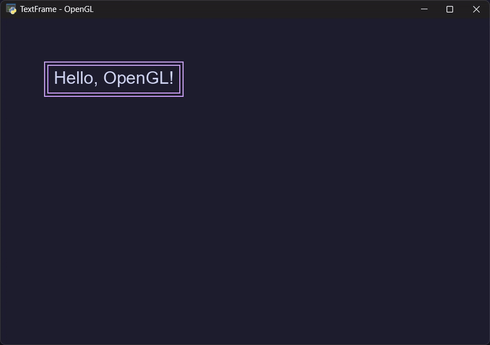

# TextFrame — Double-Framed Text Renderer (Python / SDL3)

**English** | [Русский](README.ru.md)

A Python graphics application built with SDL3 that renders text inside a double decorative border, featuring dynamic scaling.

## Demo



## Task Description

Display a specified string of text on the screen starting from a given position, enclosed in a double frame. Each press of the `>` key doubles the character size, while pressing `<` halves it. Pressing `Esc` exits the application.

## Tech Stack

- **Language:** Python 3.12+
- **Package Manager:** `uv` / `pip`
- **Windowing & Rendering:** `PySDL3` (SDL3), `PyOpenGL`, Vulkan (via `SDL_Renderer`)
- **Font Rasterization:** `Pillow` (PIL)
- **Architecture:** Decoupled RHI abstraction (`IRenderer`, `ITexture`) isolating backend implementations

## Features & Controls

| Key       | Action                                          |
| :-------- | :---------------------------------------------- |
| `>` (`.`) | Scale font and frame up by `2x` (max `16.0x`)   |
| `<` (`,`) | Scale font and frame down by `2x` (min `0.25x`) |
| `Esc`     | Quit application                                |

## Setup & Run

1. Clone the repository:

```bash
git clone https://github.com
cd TextFrame
```

2. Install dependencies and run the project using your preferred tool:

**Using `uv`:**

```bash
uv sync
uv run textframe
```

**Using standard `Python` & `pip` (Windows PowerShell):**

```powershell
python -m venv .venv
.venv\Scripts\activate
pip install -e .
python -m textframe.main
```

### Quick Run (Single Command)

If the environment is already set up, you can run the application in PowerShell with a single command:

**Using `uv`:**

```powershell
uv run textframe
```

**Using `Python`:**

```powershell
.venv\Scripts\python.exe -m textframe.main
```
