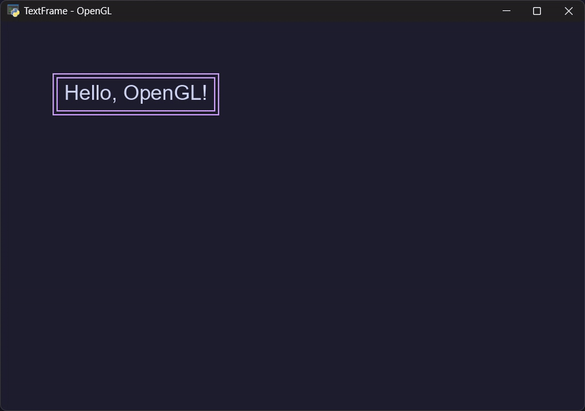

# TextFrame — Текст в двойной рамке (Python / SDL3)

[English](README.md) | **Русский**

Графическое приложение на Python с использованием SDL3, отрисовывающее текст в двойной декоративной рамке с поддержкой динамического масштабирования.

## Демонстрация работы



## Описание задачи

Выводила бы на экран, начиная с заданной позиции, заданную строку текста, заключив ее в двойную рамку. При каждом нажатии клавиш `>` размер символов должен увеличиваться в 2 раза, а при нажатии клавиши `<` — уменьшаться в 2 раза. Выход по нажатию клавиши `Esc`.

## Стек технологий

- **Язык:** Python 3.12+
- **Менеджер пакетов:** `uv` / `pip`
- **Оконная подсистема и рендеринг:** `PySDL3` (SDL3), `PyOpenGL`, Vulkan (через `SDL_Renderer`)
- **Растеризация шрифтов:** `Pillow` (PIL)
- **Архитектура:** модульный RHI-подход (`IRenderer`, `ITexture`) с полной изоляцией графических бэкендов

## Возможности и управление

| Клавиша   | Действие                                                       |
| :-------- | :------------------------------------------------------------- |
| `>` (`.`) | Увеличить масштаб шрифта и рамки в `2` раза (максимум `16.0x`) |
| `<` (`,`) | Уменьшить масштаб шрифта и рамки в `2` раза (минимум `0.25x`)  |
| `Esc`     | Выход из программы                                             |

## Установка и запуск

1. Клонируйте репозиторий:

```bash
git clone https://github.com
cd TextFrame
```

2. Установите зависимости и запустите проект удобным способом:

**С помощью `uv`:**

```bash
uv sync
uv run textframe
```

**С помощью стандартного `Python` и `pip` (Windows PowerShell):**

```powershell
python -m venv .venv
.venv\Scripts\activate
pip install -e .
python -m textframe.main
```

### Пример запуска одной командой

Если окружение уже настроено, запустить программу в PowerShell можно одной командой:

**С помощью `uv`:**

```powershell
uv run textframe
```

**С помощью `Python`:**

```powershell
.venv\Scripts\python.exe -m textframe.main
```
